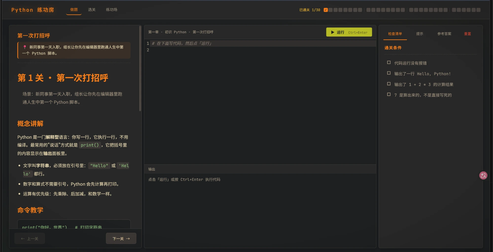
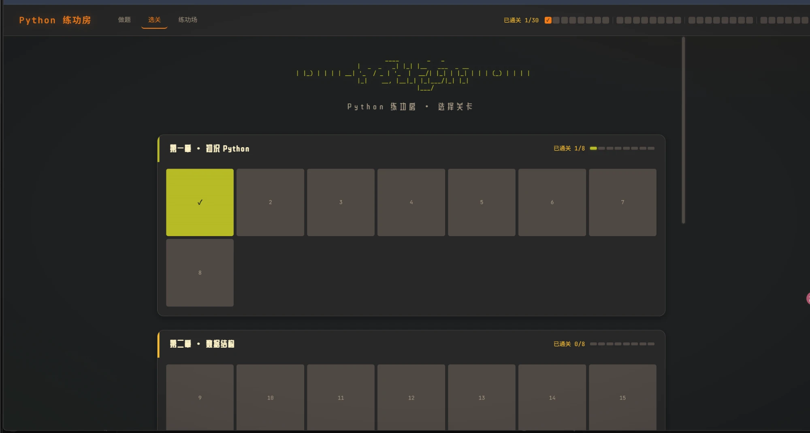
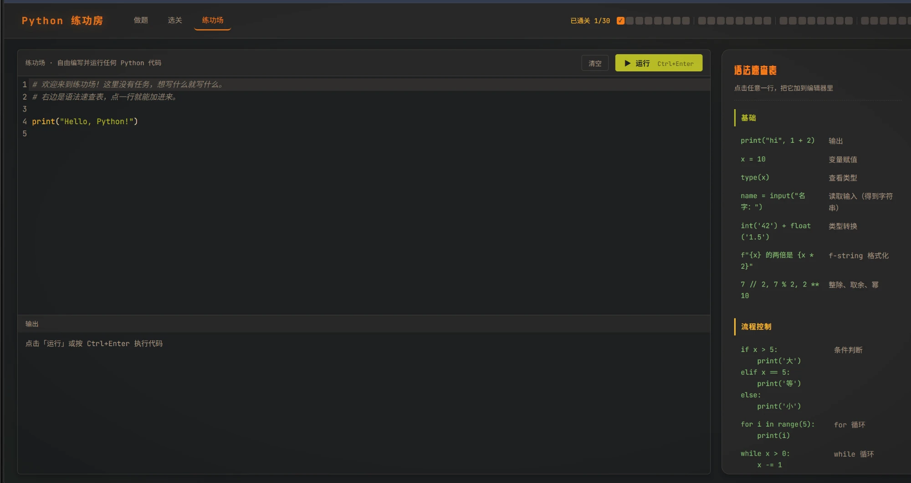

# Python 练功房

一个在浏览器里**闯关学 Python** 的小游戏：30 个关卡、4 个章节，每关有场景故事、教程、可一键载入的示例、提示、参考答案和实时的通关检查清单。

代码由 [Pyodide](https://pyodide.org)（WebAssembly 版 CPython）**真实运行**在你的浏览器里：没有后端，不上传任何代码，可以直接部署到 GitHub Pages。



## 特性

- **真·Python**：不是模拟器。写的是真正的 Python，跑的是真正的 CPython（`print`、类、装饰器、生成器、`re`、`json`、`csv`、`datetime`……标准库都能用）
- **三栏闯关界面**：左边教程，中间代码编辑器（CodeMirror，Python 语法高亮）+ 输出面板，右边检查清单；`Ctrl + Enter` 运行
- **实时检查清单**：每关 4～10 条通关条件，运行后逐条打勾；**没通过的条目会告诉你为什么**——输出类显示"期望 / 实际"并高亮差异（比如少了一个空格），变量和函数类显示实际得到的值或报错
- **提示与参考答案**：卡关时先看提示，实在不行再点开参考答案
- **游戏化反馈**：全部条件打勾后弹出庆祝动画，选关页按章节显示进度；进度和写了一半的代码都自动保存在浏览器里，刷新不丢
- **练功场**：不限题目的自由编辑器 + 按主题分组的语法速查表，点一行就能加进编辑器
- **安全**：死循环 5 秒自动终止，输出和代码长度有上限，用户代码无法联网（详见[安全](#安全)）

<table>
  <tr>
    <td width="50%"></td>
    <td width="50%"></td>
  </tr>
  <tr>
    <td align="center">选关页</td>
    <td align="center">练功场</td>
  </tr>
</table>

## 关卡

| 章节 | 关卡 | 内容 |
| --- | --- | --- |
| 第一章 · 初识 Python | 1–8 | print、变量与类型、运算符、字符串与 f-string、input 与类型转换、条件判断、for、while |
| 第二章 · 数据结构 | 9–16 | 列表、切片、字典、集合与元组、列表推导式、排序与 key、enumerate 与 zip、综合：词频统计 |
| 第三章 · 函数与面向对象 | 17–24 | 函数与默认参数、`*args/**kwargs`、作用域与闭包、装饰器、类与对象、继承与 `super`、魔术方法、生成器与迭代器 |
| 第四章 · 工程实战 | 25–30 | 异常处理、文件读写、JSON、模块与 import、正则表达式、终极关：员工统计报告 |

题目的玩法有两种：**写脚本**（检查输出和源码，如"必须用列表推导式"），以及**补全函数**（评分时用隐藏的测试用例调用你写的函数，而且会换一份数据再测，所以写死答案是过不了关的）。

## 快速开始

需要 Node.js 20+。

```bash
npm ci
npm run dev       # http://localhost:5173/python-dojo/
```

其他命令：

```bash
npm test          # 校验引擎、检查器，并把 30 关的参考答案都真实执行一遍
npm run build     # 产物在 dist/，可直接部署
npm run preview   # 预览构建产物（带严格 CSP，和线上一致）
```

> 第一次打开页面时需要加载约 13MB 的 Python 运行时（WASM + 标准库），之后浏览器会缓存。运行时文件来自本站同源，不依赖任何 CDN。

## 项目结构

```
src/
├── core/               # 与界面无关的核心逻辑（都有单元测试）
│   ├── pyExec.ts       #   在 Pyodide 里执行代码、收集输出、求值检查表达式
│   ├── pyWorker.ts     #   Web Worker 入口（用户代码跑在这里）
│   ├── pyRunner.ts     #   主线程侧的 Runner：超时终止、崩溃恢复
│   ├── checker.ts      #   检查规则求值 + 没通过时的"期望/实际"线索
│   ├── limits.ts       #   代码长度、输出大小上限
│   └── frameGuard.ts   #   防点击劫持
├── levels/
│   ├── mainLevels.ts   #   关卡顺序（数组顺序即关卡顺序）
│   └── main/levelN/    #   每关：index.ts（元数据、检查规则、答案） + README.md（教程）
├── components/         # CodeEditor、OutputPanel、CheckList、TaskAssist ……
├── pages/              # 做题页、选关页、练功场
└── stores/             # 通关进度与草稿（Pinia + localStorage，恢复时做校验）
```

技术栈：Vue 3 · TypeScript · Vite · Pinia · Vue Router · CodeMirror 6 · Pyodide · Vitest。

## 新增一关

1. 在 `src/levels/main/` 下新建 `levelN/`，写两个文件：
   - `index.ts`：标题、场景、初始代码 `starter`、`hint`、参考答案 `answer`、检查规则 `checks`、示例 `examples`
   - `README.md`：教程（概念讲解 → 命令教学 → 本关任务 → 小贴士）
2. 在 `src/levels/mainLevels.ts` 里按顺序注册。
3. 跑 `npm test`，会自动验证：**参考答案必须通过全部检查**、**初始代码不能直接通关**、**示例代码都能无错运行**。

检查规则（`src/core/types.ts` 里的 `CheckRule`）：

| 规则 | 含义 |
| --- | --- |
| `noError` | 代码运行没有抛异常、没有超时 |
| `stdoutEquals` | 输出（去掉首尾空白）等于给定文本 |
| `stdoutMatches` | 输出匹配正则；可带 `example` 用于没通过时显示期望值 |
| `codeMatches` / `codeForbids` | 源码必须 / 不能匹配某个正则（如强制用 `for`、禁止 `sum()`） |
| `exprEquals` | 代码运行后，在其命名空间里求值一个 Python 表达式并与期望值比较——既能测变量，也能调用用户写的函数，如 `grade(95)` |

## 安全

线上版是**纯静态站点**，用户代码只在自己浏览器的 WebAssembly 沙箱里运行。主要防护：

- Pyodide **自托管**并由 lockfile 锁定版本，不从第三方 CDN 加载
- 严格的 **CSP**（`connect-src 'self'`）：用户代码无法向外网发请求；运行代码的 Worker 用内联 blob 创建以继承该策略
- 运行超时 5 秒强制终止并重建，输出上限 100KB，代码长度上限 50,000 字符，崩溃自动恢复
- 防点击劫持、`localStorage` 恢复时的数据校验、教程 Markdown 禁用原始 HTML
- CI：`npm ci` + `npm audit`，GitHub Actions 固定到提交 SHA，Dependabot 每周检查更新

完整说明和已知限制见 [SECURITY.md](SECURITY.md)。

## 部署到 GitHub Pages

1. 仓库 Settings → Pages → Source 选 **GitHub Actions**
2. 推送到 `main`，`.github/workflows/deploy.yml` 会自动测试、构建并部署
3. `vite.config.ts` 里的 `base`（当前为 `/python-dojo/`）需要与仓库名一致

## 致谢

界面与关卡框架的思路来自 Linux 练功房（一个在浏览器里学 Linux 命令的闯关项目）。

## 许可

MIT
